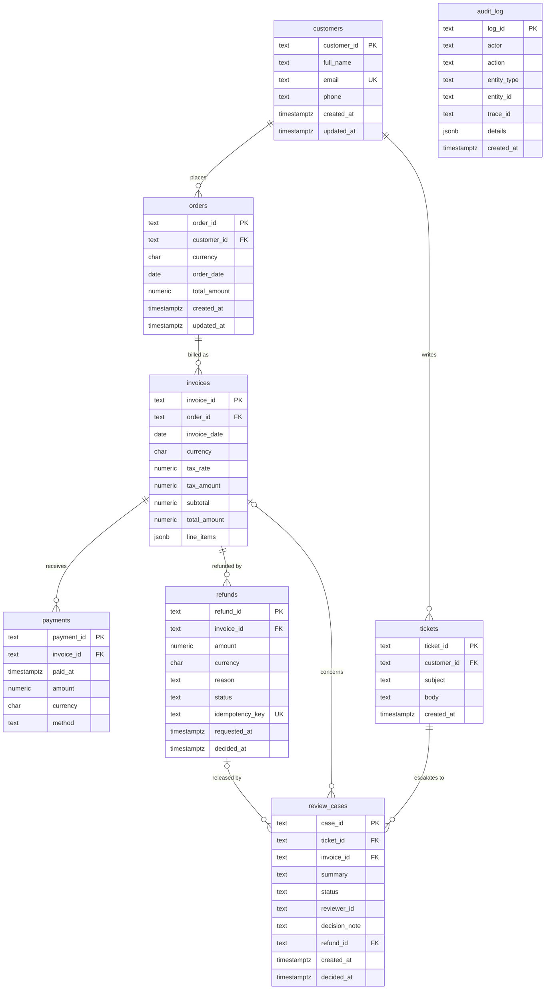

# Schema Design

PostgreSQL tables for the billing dispute agent. Tables are designed one at a time; decisions that
were deferred are listed at the end.

## Planned tables

Designed: `customers`, `orders`, `invoices`, `payments`, `refunds`, `tickets`, `review_cases`, `audit_log`.

Not designed yet: `defect_labels` (hidden ground truth, lives with the generator), `invoice_extractions` (optional, only if PDF extraction is built).

Not in this schema: `policy_sections` — the refund policy is indexed in a vector store, not stored as a Postgres table.

## Entity-relationship diagram

Two things the diagram cannot express:

- `audit_log` has no foreign key. `entity_type` and `entity_id` point at any table, so it is drawn unconnected on purpose.
- `invoices.line_items` is embedded JSONB, not a separate table, so it appears as a column and not as an entity.

## customers

One row per customer account.

| Column | Type | Constraints | Description |
| --- | --- | --- | --- |
| `customer_id` | `TEXT` | PK, `CUST-<uuid>` | Prefixed UUID derived from the seed, so the dataset is reproducible |
| `full_name` | `TEXT` | NOT NULL | Person's name; removed from traces and logs |
| `email` | `TEXT` | NOT NULL, UNIQUE | Contact address; removed from traces and logs |
| `phone` | `TEXT` | NOT NULL | Contact number; removed from traces and logs |
| `created_at` | `TIMESTAMPTZ` | NOT NULL, DEFAULT `now()` | When the row was created |
| `updated_at` | `TIMESTAMPTZ` | NOT NULL, DEFAULT `now()` | When the row last changed |

## orders

One row per purchase. Invoices hang off an order, and the order's currency is what the invoice currency is checked against.

| Column | Type | Constraints | Description |
| --- | --- | --- | --- |
| `order_id` | `TEXT` | PK, `ORD-<uuid>` | Prefixed UUID |
| `customer_id` | `TEXT` | NOT NULL, FK → `customers(customer_id)` | Who placed the order |
| `currency` | `CHAR(3)` | NOT NULL, CHECK IN ('USD','EUR') | Billing currency |
| `order_date` | `DATE` | NOT NULL | When the order was placed |
| `total_amount` | `NUMERIC(12,2)` | NOT NULL | Order value before invoicing |
| `created_at` | `TIMESTAMPTZ` | NOT NULL, DEFAULT `now()` | When the row was created |
| `updated_at` | `TIMESTAMPTZ` | NOT NULL, DEFAULT `now()` | When the row last changed |

## invoices

One row per invoice. Line items are embedded as JSONB rather than stored in their own table.

| Column | Type | Constraints | Description |
| --- | --- | --- | --- |
| `invoice_id` | `TEXT` | PK, `INV-<uuid>` | Prefixed UUID; the only identifier of an invoice |
| `order_id` | `TEXT` | NOT NULL, FK → `orders(order_id)` | The order being billed |
| `invoice_date` | `DATE` | NOT NULL | Issue date; the refund window is measured from here |
| `currency` | `CHAR(3)` | NOT NULL | Must match the order currency |
| `tax_rate` | `NUMERIC(5,4)` | NOT NULL | Rate applied, stored so a wrong rate is visible |
| `tax_amount` | `NUMERIC(12,2)` | NOT NULL | Tax charged |
| `subtotal` | `NUMERIC(12,2)` | NOT NULL | Sum of line items before tax |
| `total_amount` | `NUMERIC(12,2)` | NOT NULL | Subtotal plus tax |
| `line_items` | `JSONB` | NOT NULL | Array of line item objects, described below |

`line_items` holds a list of objects:

| Key | Type | Description |
| --- | --- | --- |
| `product_name` | `TEXT` | Item being billed |
| `description` | `TEXT` | Free-text detail |
| `quantity` | `INTEGER` | Units billed |
| `unit_price` | `NUMERIC(12,2)` | Price per unit |

## payments

Money received against an invoice. Two rows against the same invoice are how a double charge is detected.

| Column | Type | Constraints | Description |
| --- | --- | --- | --- |
| `payment_id` | `TEXT` | PK, `PAY-<uuid>` | Prefixed UUID |
| `invoice_id` | `TEXT` | NOT NULL, FK → `invoices(invoice_id)` | Invoice being paid |
| `paid_at` | `TIMESTAMPTZ` | NOT NULL | Includes time, so two charges on one day can be compared |
| `amount` | `NUMERIC(12,2)` | NOT NULL | Amount received |
| `currency` | `CHAR(3)` | NOT NULL | Currency of the payment |
| `method` | `TEXT` | NOT NULL | card, bank transfer, or similar |

## refunds

Money returned to the customer. Written only by `issue_refund`.

| Column | Type | Constraints | Description |
| --- | --- | --- | --- |
| `refund_id` | `TEXT` | PK, `REF-<uuid>` | Prefixed UUID |
| `invoice_id` | `TEXT` | NOT NULL, FK → `invoices(invoice_id)` | Invoice being refunded |
| `amount` | `NUMERIC(12,2)` | NOT NULL, CHECK `amount > 0` | Amount returned |
| `currency` | `CHAR(3)` | NOT NULL | Currency of the refund |
| `reason` | `TEXT` | NOT NULL | Why the refund was issued |
| `status` | `TEXT` | NOT NULL, CHECK IN ('pending','approved','rejected','issued') | Only `issued` counts as money returned |
| `idempotency_key` | `TEXT` | NOT NULL, UNIQUE | One key per logical refund; a retry returns the existing row instead of paying twice |
| `requested_at` | `TIMESTAMPTZ` | NOT NULL, DEFAULT `now()` | When the refund was requested |
| `decided_at` | `TIMESTAMPTZ` | NULL | When it was approved, rejected, or issued |

## tickets

The customer's message, and the agent's input.

| Column | Type | Constraints | Description |
| --- | --- | --- | --- |
| `ticket_id` | `TEXT` | PK, `TKT-<uuid>` | Prefixed UUID |
| `customer_id` | `TEXT` | NOT NULL, FK → `customers(customer_id)` | Who wrote in; used for the authorization check |
| `subject` | `TEXT` | NULL | Short summary line |
| `body` | `TEXT` | NOT NULL | The message; treated as untrusted input |
| `created_at` | `TIMESTAMPTZ` | NOT NULL, DEFAULT `now()` | When the ticket arrived |

## review_cases

A ticket handed to a human. Written by `escalate_to_human`, updated by the review queue.

| Column | Type | Constraints | Description |
| --- | --- | --- | --- |
| `case_id` | `TEXT` | PK, `CASE-<uuid>` | Prefixed UUID |
| `ticket_id` | `TEXT` | NOT NULL, FK → `tickets(ticket_id)` | Ticket being escalated |
| `invoice_id` | `TEXT` | NULL, FK → `invoices(invoice_id)` | The invoice in question, if one was identified |
| `summary` | `TEXT` | NOT NULL | Short case summary for the reviewer |
| `status` | `TEXT` | NOT NULL, CHECK IN ('pending','approved','rejected') | Reviewer's decision |
| `reviewer_id` | `TEXT` | NULL | Who decided |
| `decision_note` | `TEXT` | NULL | Why they decided that |
| `refund_id` | `TEXT` | NULL, FK → `refunds(refund_id)` | Refund released by an approval |
| `created_at` | `TIMESTAMPTZ` | NOT NULL, DEFAULT `now()` | When the case was created |
| `decided_at` | `TIMESTAMPTZ` | NULL | When the reviewer decided |

## audit_log

Append-only record of every action that moves money. Not read by the agent.

| Column | Type | Constraints | Description |
| --- | --- | --- | --- |
| `log_id` | `TEXT` | PK, `LOG-<uuid>` | Prefixed UUID |
| `actor` | `TEXT` | NOT NULL | Who acted: `agent` or `reviewer:<id>` |
| `action` | `TEXT` | NOT NULL | What happened, e.g. `refund.requested` |
| `entity_type` | `TEXT` | NOT NULL | Kind of record affected |
| `entity_id` | `TEXT` | NOT NULL | Id of that record |
| `trace_id` | `TEXT` | NULL | Phoenix trace of the run that caused it |
| `details` | `JSONB` | NULL | Snapshot of the values involved |
| `created_at` | `TIMESTAMPTZ` | NOT NULL, DEFAULT `now()` | When it happened |

## Decision points and deferred items

Current state, and what may change later:

- `invoices` has no `status` column. Payment state is derived from `payments` and `refunds`; a stored status may be added if search becomes slow.
- `invoices` and `payments` have no `created_at` / `updated_at`, while `customers` and `orders` do. Consistency to revisit.
- `invoices.invoice_number` was removed; `invoice_id` alone identifies an invoice.
- `invoices.customer_id` was removed; the customer is reached through `orders`.
- `invoice_line_items` is not a table; line items are JSONB inside `invoices`. May become a table again if querying items individually is needed.
- `tickets` has no `status`; an escalation is visible because a `review_cases` row exists.
- `audit_log.log_id` uses `LOG-<uuid>`; may become `BIGINT` if volume and ordering matter.
- `review_cases.refund_id` assumes one refund per case.
- Foreign keys use `ON DELETE CASCADE`: deleting a parent removes its children, so no delete is ever blocked by a reference. `audit_log` has no foreign key and is never removed by a cascade.
- The missing-field defect is dropped for now, so every `invoices` column stays `NOT NULL`.
- Indexes are not designed yet.
- `defect_labels` and `invoice_extractions` are not designed yet.
- `policy_sections` will live in the vector store, not in this schema.
